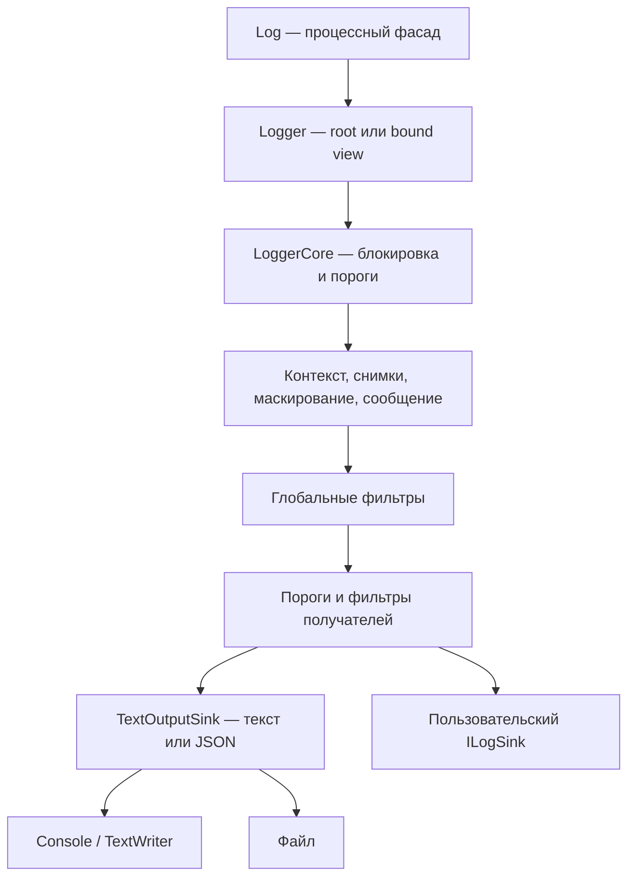

# Архитектура MVP

[Русский](ARCHITECTURE.md) · [English](en/ARCHITECTURE.md) · [Deutsch](de/ARCHITECTURE.md)

[Оглавление](README.md) · [Публичный API](API.md) · [Разработка](DEVELOPMENT.md)

## Общая схема

Один подготовленный `LogEvent` используется всеми получателями. У root и его
bound views общие ресурсы, порядок dispatch и цепочка async-контекста.
У независимых roots эти механизмы раздельны.

## Публичный слой

`Logger.Create(Action<LoggerConfiguration>)` собирает независимый экземпляр.
`Enrich` и `WriteTo` возвращают основной builder для цепочек fluent API.
Настройки встроенных sinks фиксируются при регистрации; свойства, фильтры и
правила основного builder фиксируются при создании ядра. После этого builder
не участвует в обработке событий.

`Log` — процессный фасад над отдельным root-логгером. Синхронизация фасада
защищает замену экземпляра относительно записей через фасад. Основной путь
для сервисов и тестов — отдельный `Logger` с явным временем жизни.

## Поток события

1. Проверить состояние root/view и минимальные уровни логгера и получателей.
2. Под блокировкой root собрать глобальные свойства, async-контекст, `Bind`
   и свойства шаблона. Приоритет возрастает в этом порядке.
3. Зафиксировать значения: простые типы сохраняются, сложные объекты становятся
   независимыми `JsonElement`. Циклические/несериализуемые значения сообщают об ошибке.
4. Применить маскирование строковых значений, включая вложенные структуры.
   Сформировать сообщение и снимок исключения, применить маскирование к тексту.
5. Создать неизменяемый `LogEvent`. Глобальные фильтры видят обработанное событие.
6. Для каждого sink применить его уровень и фильтр. Встроенные sinks выполняют
   форматирование в текст или JSON и синхронную запись.

Событие не передаётся ни одному sink, если его подготовка или маскирование
завершились ошибкой. Ошибка конкретного sink изолирована от остальных sinks.
Все сбои направляются в `OnError`, его исключения подавляются.

## Время жизни и конкурентность

Одна блокировка root защищает подготовку, dispatch, flush и dispose. Это даёт
одинаковый порядок событий во всех sinks и предотвращает запись в закрытый файл.
Медленный sink удерживает поток, пишущий лог; ограниченная очередь — будущий этап.

`Bind` разделяет ядро, но хранит собственный неизменяемый набор свойств.
Его `Dispose` закрывает view. Закрытие root делает все views недействительными.
Встроенный file sink принадлежит root; пользовательский sink по умолчанию
принадлежит вызывающему коду. Каждый distinct owned sink закрывается один раз.
При частичном провале создания уже открытые owned sinks закрываются.

Контекст представлен цепочкой узлов в `AsyncLocal`. Scope не хранит общий
флаг disposed: закрытие унаследованного scope в дочернем ExecutionContext
не должно мешать родительскому контексту завершить свою область.
Нарушение LIFO в том же потоке выбрасывает исключение, сохраняя текущий контекст.

Повторный вход в тот же root во время dispatch/flush пропускает вложенную
запись. Закрытие root из его собственного обработчика запрещено. Sink и
`OnError` не должны вызывать операции жизненного цикла своего логгера или
строить взаимные циклы между разными логгерами.

## Caller info

Короткие методы сохраняют API `Info(template, params values)`. Caller info
вычисляется через `StackTrace` только при `WithCaller`. Компиляторные
caller-атрибуты потребовали бы другого контракта аргументов. Следствие:
зависимость исходной строки от PDB и влияние JIT/inlining на видимый frame.

## Границы

Файлы используют append, UTF-8 без BOM, `FileShare.Read` и AutoFlush.
Один активный writer владеет файлом. Ротация, retention, координация нескольких
процессов и фоновые очереди пока не реализованы. Снимки исключений включают
сообщение, stack trace и вложенные исключения; произвольный `Exception.Data`
не включается. Внешних runtime-пакетов у основной библиотеки нет.

## Карта исходников

| Файл | Ответственность |
| --- | --- |
| [Logger.cs](../Trexon.Logging/Logger.cs) | Factory, публичная валидация, views, scopes и операции записи |
| [Log.cs](../Trexon.Logging/Log.cs) | Синхронизация процессного фасада и замена root |
| [LoggerConfiguration.cs](../Trexon.Logging/LoggerConfiguration.cs) | Fluent builder, правила, свойства и фабрики sinks |
| [SinkConfiguration.cs](../Trexon.Logging/SinkConfiguration.cs) | Настройки и снимки встроенного вывода |
| [LoggerCore.cs](../Trexon.Logging/Internal/LoggerCore.cs) | Pipeline, AsyncLocal, error reporting, синхронизация и закрытие |
| [MessageTemplate.cs](../Trexon.Logging/Internal/MessageTemplate.cs) | Разбор, связывание аргументов и invariant rendering |
| [PropertyValues.cs](../Trexon.Logging/Internal/PropertyValues.cs) | Снимки сложных значений и рекурсивное маскирование строк |
| [JsonFormatting.cs](../Trexon.Logging/Internal/JsonFormatting.cs) | Общие настройки JSON с читаемым Unicode |
| [TextOutputSink.cs](../Trexon.Logging/Internal/TextOutputSink.cs) | Формат текста/JSON, цвета, writer и sink registrations |
| [LogEvent.cs](../Trexon.Logging/LogEvent.cs) | Неизменяемые события, caller и exception snapshots |
| [ILogSink.cs](../Trexon.Logging/ILogSink.cs) | Публичный контракт расширения и модель технической ошибки |

Изменение публичной сигнатуры отражается в [API.md](API.md), изменение pipeline —
в соответствующем руководстве. [Проверки](DEVELOPMENT.md) подтверждают отдельные
поведенческие контракты; диаграмма сама по себе их не заменяет.
