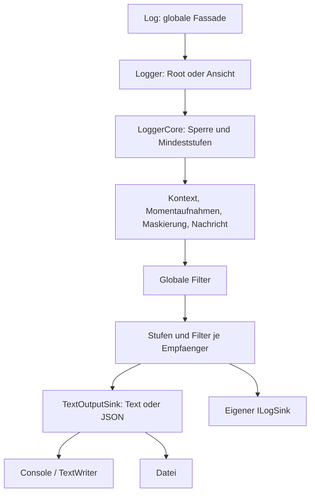

# Architektur des MVP

[Русский](../ARCHITECTURE.md) · [English](../en/ARCHITECTURE.md) · [Deutsch](../de/ARCHITECTURE.md)

[Übersicht](README.md) · [API](API.md) · [Entwicklung](DEVELOPMENT.md)

## Überblick

Alle Empfänger erhalten dasselbe vorbereitete LogEvent. Root und Ansichten teilen
Ressourcen, Ausgabereihenfolge und asynchronen Kontext; unabhängige Roots nicht.

## Öffentliche Schicht und Verarbeitung

Logger.Create erstellt eine unabhängige Instanz. Enrich und WriteTo geben den
Haupt-Builder zurück. Optionen eingebauter Empfänger werden bei der Registrierung
erfasst, globale Eigenschaften, Filter und Regeln beim Erstellen des Kerns.
Builder nehmen danach nicht an der Ereignisverarbeitung teil. Log synchronisiert
den Austausch des globalen Roots mit Fassade-Aufrufen. Für Dienste und isolierte
Tests explizite Logger-Lebenszyklen verwenden.

1. Zustand von Root/Ansicht und Mindeststufen prüfen.
2. Unter der Root-Sperre globale Eigenschaften, asynchrone Scopes, Bind und
   Vorlagenargumente mit aufsteigender Priorität zusammenführen.
3. Einfache Werte und unabhängige JsonElement-Momentaufnahmen komplexer Werte erfassen.
   Zyklen und ungeeignete Objekte können die Erfassung verhindern.
4. Verschachtelte Zeichenfolgen maskieren, Nachricht bilden, Ausnahmen/Aufrufer
   erfassen und Textmaskierung anwenden.
5. Unveränderliches LogEvent erstellen und globale Filter ausführen.
6. Stufe/Filter jedes Empfängers anwenden, eingebaute Formate erzeugen und synchron schreiben.

Vorbereitungs- oder Maskierungsfehler verhindern die Ausgabe vollständig. Fehler
eines Empfängers bleiben von anderen isoliert. Ereignis- und Empfängerfehler gehen
an OnError; Konfigurations- und Erstellungsfehler können direkt geworfen werden.
Ausnahmen des Fehlerhandlers werden unterdrückt.

## Lebenszyklus und Parallelität

Eine Root-Sperre schützt Vorbereitung, Ausgabe, Flush und Dispose. Empfänger sehen
dieselbe Reihenfolge und schreiben nicht gleichzeitig mit dem Schließen ihrer Datei.
Langsame Empfänger blockieren den aufrufenden Thread; eine begrenzte Warteschlange
ist geplant. Bind teilt den Kern mit unveränderlichen eigenen Eigenschaften.
Dispose einer Ansicht betrifft nur sie, Root-Dispose alle Ansichten. Dateien gehören
dem Root, eigene Empfänger standardmäßig dem Aufrufer. Jede eigene Ressourceninstanz
wird einmal geschlossen, auch bei teilweise fehlgeschlagener Initialisierung.

AsyncLocal enthält eine verkettete Scope-Struktur. Ein Scope besitzt kein gemeinsam
geteiltes Dispose-Flag, damit Aufräumen im untergeordneten ExecutionContext das
Aufräumen des Elternkontexts nicht verhindert. Verstöße gegen LIFO werfen und
bewahren die Kette. Rekursive Einträge während Ausgabe/Flush werden übersprungen;
Root-Schließen im Callback ist verboten. Callback-Zyklen zwischen Roots vermeiden.

## Aufrufer und Grenzen

WithCaller aktiviert StackTrace-Auswertung. Compilerattribute für Aufruferdaten
würden andere Methodensignaturen benötigen. PDB, JIT und Inlining beeinflussen die
Quellposition. Dateien verwenden UTF-8 ohne BOM, Anhängen, FileShare.Read und AutoFlush.
Ein aktiver Writer besitzt eine Datei. Prozessübergreifende Koordination, Rotation,
Aufbewahrungsregeln und Warteschlange fehlen. Ausnahmemomentaufnahmen enthalten Data
nicht. Die Kernbibliothek hat keine externen Runtime-Pakete.

## Quelldateien

| Datei | Verantwortung |
| --- | --- |
| [Logger.cs](../../Trexon.Logging/Logger.cs) | Erstellung, Validierung, Ansichten, Scopes, Schreiben |
| [Log.cs](../../Trexon.Logging/Log.cs) | Globale Fassade und Root-Austausch |
| [LoggerConfiguration.cs](../../Trexon.Logging/LoggerConfiguration.cs) | Builder, Regeln, Eigenschaften, Empfängerfabriken |
| [SinkConfiguration.cs](../../Trexon.Logging/SinkConfiguration.cs) | Ausgabeoptionen und Momentaufnahmen |
| [LoggerCore.cs](../../Trexon.Logging/Internal/LoggerCore.cs) | Verarbeitung, AsyncLocal, Fehler, Sperren, Lebenszyklus |
| [MessageTemplate.cs](../../Trexon.Logging/Internal/MessageTemplate.cs) | Parser, Argumentbindung, kulturunabhängige Darstellung |
| [PropertyValues.cs](../../Trexon.Logging/Internal/PropertyValues.cs) | Objektmomentaufnahmen und rekursive Maskierung |
| [JsonFormatting.cs](../../Trexon.Logging/Internal/JsonFormatting.cs) | Gemeinsame JSON-Optionen für lesbares Unicode |
| [TextOutputSink.cs](../../Trexon.Logging/Internal/TextOutputSink.cs) | Text/JSON, Farben und Writer |
| [LogEvent.cs](../../Trexon.Logging/LogEvent.cs) | Ereignis-, Aufrufer- und Ausnahmemodelle |
| [ILogSink.cs](../../Trexon.Logging/ILogSink.cs) | Erweiterungsvertrag und technischer Fehler |

Bei Signaturänderungen API.md und bei Verhaltensänderungen die Anleitungen anpassen.
[Prüfungen](DEVELOPMENT.md) bestätigen einzelne Verträge; eine Grafik ersetzt sie nicht.
