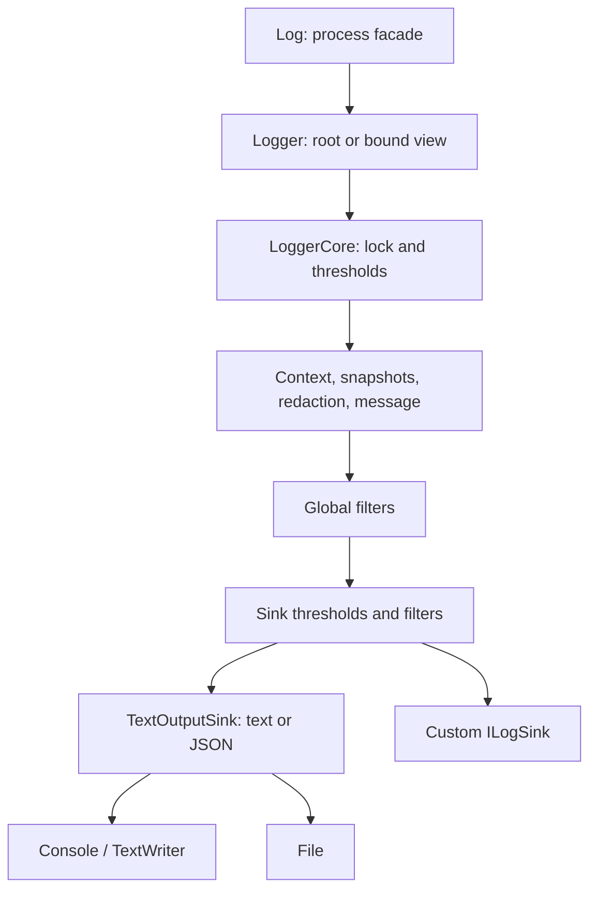

# MVP architecture

[Русский](../ARCHITECTURE.md) · [English](../en/ARCHITECTURE.md) · [Deutsch](../de/ARCHITECTURE.md)

[Index](README.md) · [API](API.md) · [Development](DEVELOPMENT.md)

## Overview

Every sink receives the same prepared LogEvent. A root and its views share resources,
dispatch ordering, and async context. Independent roots keep these separate.

## Public layer and event flow

Logger.Create builds an independent instance. Enrich and WriteTo return the main
builder. Built-in sink options are captured at registration; main properties,
filters, and rules at core creation. Builders do not process later events.
Log synchronizes process-root replacement against facade writes. Use explicit
Logger lifetimes for services and isolated tests.

1. Validate root/view state and logger/sink thresholds.
2. Under the root lock, combine global properties, async scopes, bound properties,
   and template properties, in increasing precedence.
3. Capture simple values and independent JsonElement snapshots of complex values.
   Cycles and unsupported objects can fail capture.
4. Redact nested string values, render the message, capture exception/caller details,
   and apply text redaction.
5. Create the immutable LogEvent, then evaluate global filters.
6. Apply each sink's level/filter, format built-ins as text or JSON, and write synchronously.

Preparation/redaction failure prevents dispatch to every sink. One sink's failure
is isolated from the rest. Event and sink failures are reported to OnError;
configuration/creation failures can throw directly. Handler exceptions are suppressed.

## Lifetime and concurrency

One root lock protects preparation, dispatch, flush, and disposal. Sinks see the same
order and cannot race that root's file closure. Slow sinks block the logging thread;
a bounded queue is planned. Bind shares the core with an immutable property set.
View Dispose affects only that view; root Dispose invalidates all views. Files are
root-owned, custom sinks caller-owned by default. Each distinct owned sink is
closed once, including cleanup after partial initialization failure.

AsyncLocal stores a linked scope chain. A lease has no shared disposed flag, so
child ExecutionContext cleanup cannot prevent parent cleanup. LIFO violations
throw while preserving the chain. Reentrant writes during dispatch/flush are
skipped; root closure from a callback is forbidden. Avoid callback cycles between roots.

## Caller and limits

Caller capture uses StackTrace when WithCaller is enabled. Compiler caller
attributes would require different method signatures. PDB availability, JIT, and
inlining therefore affect source locations. Files use UTF-8 without BOM, append,
FileShare.Read, and AutoFlush. One active writer owns a file; no multiprocess
coordination, rotation, retention, or queue exists. Exception snapshots omit Data.
The core library has no external runtime packages.

## Source map

| File | Responsibility |
| --- | --- |
| [Logger.cs](../../Trexon.Logging/Logger.cs) | Factory, validation, views, scopes, writes |
| [Log.cs](../../Trexon.Logging/Log.cs) | Process facade and root replacement |
| [LoggerConfiguration.cs](../../Trexon.Logging/LoggerConfiguration.cs) | Builder, rules, properties, sink factories |
| [SinkConfiguration.cs](../../Trexon.Logging/SinkConfiguration.cs) | Built-in output options and snapshots |
| [LoggerCore.cs](../../Trexon.Logging/Internal/LoggerCore.cs) | Pipeline, AsyncLocal, errors, locks, lifecycle |
| [MessageTemplate.cs](../../Trexon.Logging/Internal/MessageTemplate.cs) | Parsing, binding, invariant rendering |
| [PropertyValues.cs](../../Trexon.Logging/Internal/PropertyValues.cs) | Complex snapshots and recursive redaction |
| [JsonFormatting.cs](../../Trexon.Logging/Internal/JsonFormatting.cs) | Shared readable-Unicode JSON options |
| [TextOutputSink.cs](../../Trexon.Logging/Internal/TextOutputSink.cs) | Text/JSON formatting, colors, writers |
| [LogEvent.cs](../../Trexon.Logging/LogEvent.cs) | Immutable event, caller, exception models |
| [ILogSink.cs](../../Trexon.Logging/ILogSink.cs) | Extension contract and technical failure model |

Update API.md when signatures change and feature guides when behavior changes.
[Checks](DEVELOPMENT.md) verify particular contracts; a diagram alone does not.
